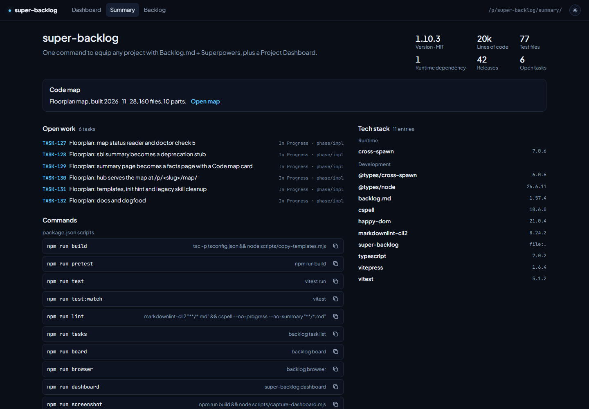

# Project summary page

Every project registered with the dashboard hub gets a second page next to the
dashboard: a management summary at `/p/<slug>/summary/`. The dashboard is about
work in progress; the summary answers what the project is, what it is built
with and where the open work sits. The picture of the code itself comes from
[Floorplan](https://github.com/haydenschmitty/floorplan), an agent plugin that
draws an interactive map of the codebase; the summary page links to that map.

## Open the page

```bash
sbl dashboard
```

Use the **Summary** tab under the project name in the dashboard sidebar, or open
`http://localhost:6428/p/<slug>/summary/` directly. The summary page has tabs
back to the **Dashboard** and to the full-page **Backlog** browser. Both pages
share the theme toggle and reload automatically when anything under `backlog/`
changes. On Windows under Node 24 live reload is disabled due to a libuv bug,
as for the dashboard (see
[Troubleshooting](troubleshooting.md#windows--node-24-sbl-dashboard-disables-live-reload));
refresh the browser tab manually.



## What the page shows

Everything on the page is computed by the hub; there is no file to maintain.

- **Project facts:** name, version and license from `package.json`,
  `composer.json` or a WordPress theme/plugin header; lines of code and test
  files; runtime and development dependencies; releases (git tags such as
  `v1.2.0`); CI workflows.
- **Code map:** a card with the state of the project's Floorplan map and a
  link to it (see below).
- **Tech stack** from the manifests, **commands** from the manifest scripts
  and the **open tasks** from the backlog.
- **Data source:** a collapsible section at the bottom that lists where the
  numbers come from and any warnings from collecting them.

## The Code map card

The card has three states.

| State | What the card shows |
| --- | --- |
| A map was built | "Floorplan map, built 2026-11-28, 165 files, 11 parts", the number of commits since the map was built when there are any, and the link **Open map**. |
| No map yet | A short explanation and the two install commands with copy buttons. |
| The map cannot be read | One line with the reason, for example "Floorplan map unreadable (not valid JSON)", and the advice to ask your agent to update the floorplan. |

The date is the UTC day the map was built. "Commits since" counts the commits
between the commit the map was built from and the current `HEAD`. It is
computed when the page is generated, so it is as fresh as the rest of the
page: the hub regenerates the page when the backlog changes and when the map
file changed since the last time the page was served.

## Get a map

Floorplan is a plugin for Claude Code and Codex. super-backlog does not
install it and never starts it; it only reads what the plugin wrote. For
Claude Code:

```bash
claude plugin marketplace add haydenschmitty/floorplan
claude plugin install floorplan@floorplan
```

For Codex:

```bash
codex plugin marketplace add haydenschmitty/floorplan
codex plugin add floorplan@floorplan
```

Start a new session and ask your agent to "make a floorplan". The agent reads
the codebase and writes the map into the `floorplan/` directory of the
project. Reload the summary page: the card now shows the map. The card itself
offers the two Claude Code commands with copy buttons.

After larger changes, ask the agent to "update the floorplan". The workflow
block asks the agent to do this on its own when a merge changed the structure
of a project that already has a map. The agent never creates a map unasked.

The map is personal: `floorplan/` contains its own `.gitignore`, so the map
is not committed and every checkout builds its own.

## Open the map

**Open map** leads to `/p/<slug>/map/`. The hub serves exactly one file there,
the self-contained map page `floorplan/index.html`. Parts, connections, flows
and the search work as usual.

Two features need Floorplan's own server and are off under the hub: the
**Ask** bar and saving flows. For those, start the server that ships with the
map and open the address it prints:

```bash
node floorplan/serve.mjs
```

## Check the map from the terminal

`sbl doctor` reports the map in its check 5:

| Situation | Line |
| --- | --- |
| No map | `[skip] no floorplan map (optional: install the Floorplan plugin and ask your agent to make a floorplan)` |
| Map built from the current commit | `[ok] floorplan map current (built 2026-11-28, 165 files, 11 parts)` |
| Map older than the current commit | `[ok] floorplan map built 2026-11-28, 3 commits behind HEAD (165 files, 11 parts)` |
| Map cannot be read | `[warn] floorplan/graph.json unreadable (not valid JSON)` |

A missing or older map never changes the exit code of `sbl doctor`; the map
is optional.

## Migrating from `architecture.yml`

Up to version 1.10 the summary page drew its own architecture diagram from a
curated file, `backlog/docs/architecture.yml`, written by the
`architecture-summary` skill. Floorplan replaces both.

- `backlog/docs/architecture.yml` is no longer read. `sbl doctor` points at a
  leftover file with a `[skip]` line; delete it when you no longer need it.
  super-backlog never deletes it for you.
- `sbl update` removes the `architecture-summary` skill from `.claude/skills/`
  and `.opencode/skill/` and updates the workflow block.
- `sbl summary` is deprecated. It prints a notice and the map status and
  always exits with `0`; old arguments such as `--check` are accepted and
  ignored. Remove a `sbl summary --check` step from CI when convenient: it no
  longer checks anything.
- There is no replacement for the drift check. The Code map card and
  `sbl doctor` show how many commits the map is behind instead.

## When something is wrong

- **The card says the map is unreadable:** ask your agent to update the
  floorplan. The rest of the page is not affected.
- **`/p/<slug>/map/` answers "no floorplan map":** the project has no
  `floorplan/index.html`. Build a map first.
- **The card still shows an old state:** reload the summary page. The hub
  picks up a new or rebuilt map on the next page load.
- **Unexpected render error:** the page shows the facts it could collect and
  the error message. The dashboard is never affected.
